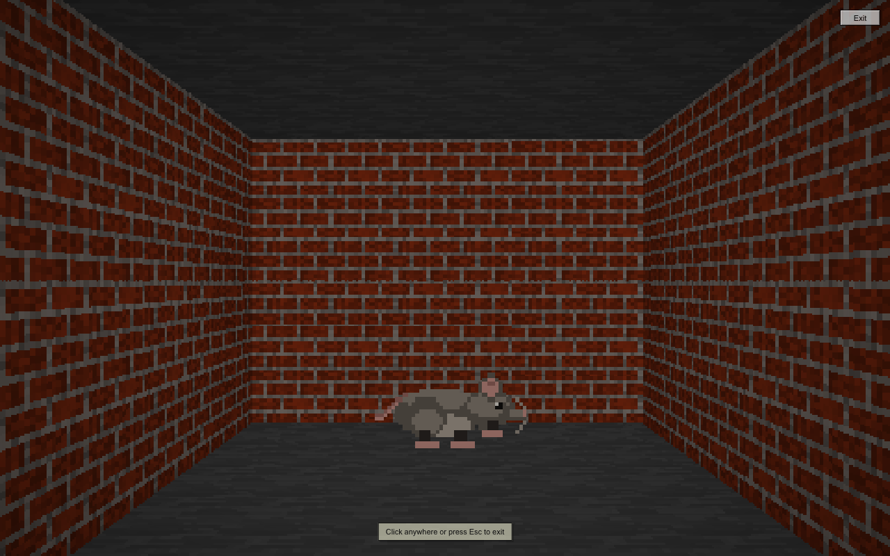
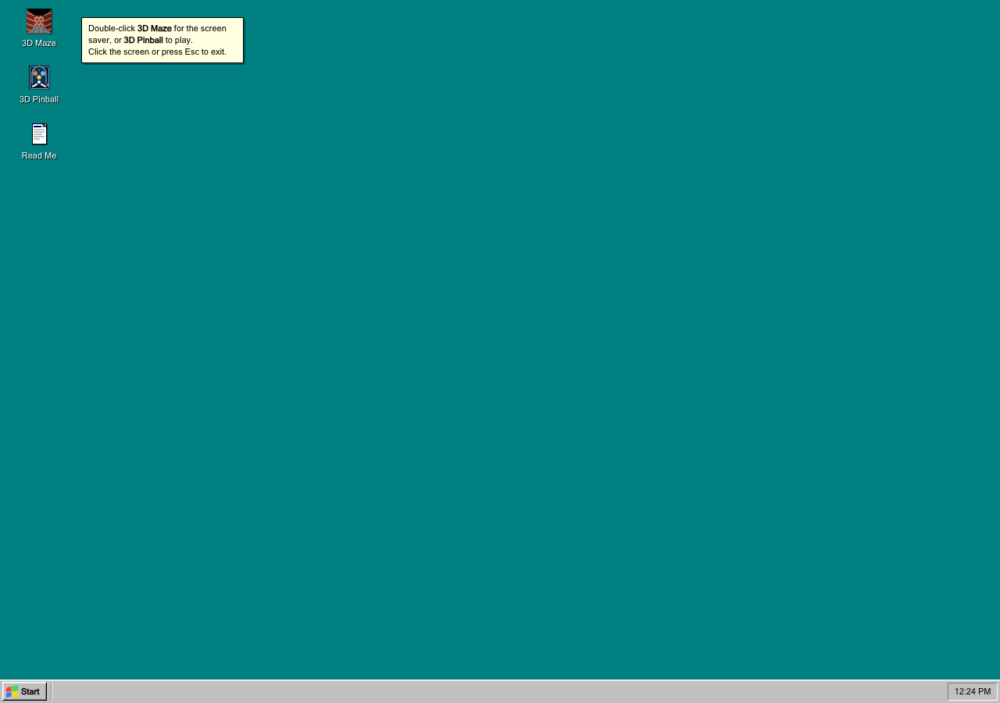
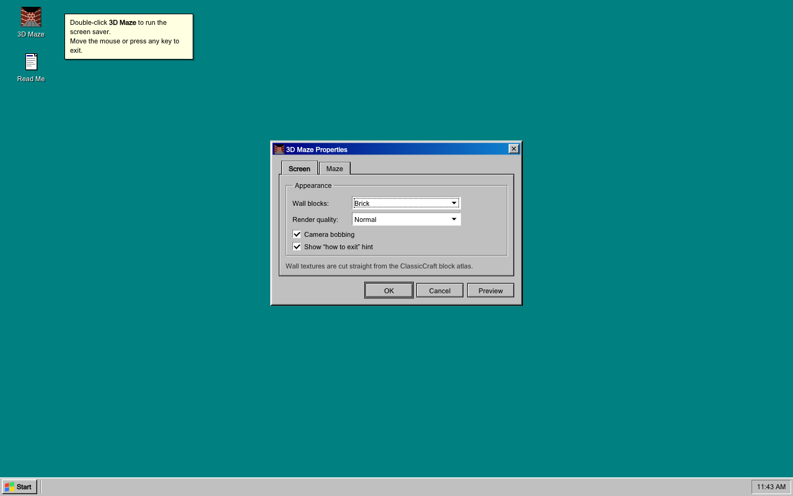

# 3D Maze — Windows 95 screen saver, remade for the web

A browser remake of the Windows 95 **3D Maze** screen saver: a dark brick maze
that wanders around by itself, rendered with a hand-written raycasting engine
and textured with blocks from
[ClassicCraft](https://github.com/HeathLoganCampbell/classiccraft).

**Play it:** <https://heathlogancampbell.github.io/win95maze/>



## What you get

- A procedural brick maze, re-dug every time the screen saver starts.
- A camera that walks the corridors on its own, slowing into the turns.
- Textured walls, floor, and ceiling, plus distance fog and per-face shading.
- A small Windows 95 desktop around it: icons, Start menu, taskbar clock,
  draggable properties window, and a proper shut-down screen.
- Full-screen screen saver that exits on mouse movement, a click, or any key.
- Settings for wall blocks, puzzle size, walking speed, render quality, and
  camera bob, saved in `localStorage`.
- No build step, no dependencies, no tracking. It is just static files.

## Run it

Double-click the **3D Maze** icon, or choose **Start → 3D Maze**.

- **Exit the screen saver:** move the mouse, click, tap, or press any key.
- **Settings:** Start → Settings (or right here in the desktop shell).
- **Read Me:** double-click the Read Me icon for the about box.
- **Shut Down:** Start → Shut Down for the orange-text send-off.

| The desktop shell | Properties |
| --- | --- |
|  |  |

To run it locally, serve the folder over HTTP — the texture loader reads pixels
from a canvas, which browsers block on `file://`:

```bash
git clone https://github.com/HeathLoganCampbell/win95maze.git
cd win95maze
python3 -m http.server 8000
# open http://localhost:8000
```

## How it works

The renderer is deliberately old-fashioned. Scenes are drawn into a small
`ImageData` buffer (300–400 pixels on the short edge) and nearest-neighbour
upscaled, which keeps the chunky 1995 look and makes every pixel cheaper.

| File | Job |
| --- | --- |
| `js/maze.js` | Recursive-backtracker maze, extra loop carving, weighted random walk, rounded Polyline path, and the camera walker. |
| `js/screensaver.js` | Canvas raycaster: DDA wall casting, textured floor/ceiling projection, distance fog, face shading, and block-atlas sampling. |
| `js/app.js` | Windows 95 desktop shell, window dragging, settings persistence, full-screen transitions, and screen-saver wake behaviour. |
| `assets/blocks.png` | The 16 × 768 ClassicCraft block atlas, copied byte-for-byte. |

The maze is a standard odd-cell grid: carve with a recursive backtracker, then
knock out a few walls so the walker can loop instead of hitting dead ends. A
long random walk (biased toward going straight) becomes a smooth polyline with
quadratic corner rounding; the camera follows it at a constant distance and
eases its heading toward a point ahead on the path.

For each screen column the renderer walks the block grid with a DDA, samples
the 16 × 16 side face of the block texture, and applies a side-dependent shade
and fog. Floor and ceiling are drawn by row-wise plane casting, before the
walls are painted over them. The camera bobs on a sine wave driven by distance
travelled, not time, so it stays in step even when the tab is throttled.

The block atlas stores three faces per block; the renderer uses the side face
(rows 16–31 of each 48-row slot). Textures repeat twice per world unit so the
bricks read at corridor scale. These are the slots used:

- **Brick** — slot 5
- **Cobblestone** — slot 11
- **Stone** (floor and ceiling) — slot 4

## Build notes

This was built in one session with an AI coding agent, and the bill is part of
the README:

| | |
| --- | --- |
| **Model** | DeepSeek V4.1 Flash 1017 (`deepseek/deepseek-flash`), via OpenCode |
| **Build cost** | ≈ **US$0.12** of model usage for the initial build |
| **Token usage** | ≈ 70k input, 47k output, 10.7M cached-input tokens (at $0.15/M input, $0.60/M output, $0.003/M cached read) |
| **Hosting** | **US$0.00** on GitHub Pages |

The figure is tracked by the harness for the build session; it is a rounded
snapshot taken while writing this file, not an invoice.

## Textures and licence

Code is MIT licensed — see [LICENSE](LICENSE).

The block textures in `assets/blocks.png` come from
[ClassicCraft](https://github.com/HeathLoganCampbell/classiccraft) by
Heath Logan Campbell, also MIT licensed. The art is used here as-is; the maze,
renderer, and Windows 95 shell are new.

Windows 95 is a trademark of Microsoft. This is an unofficial fan recreation,
not affiliated with or endorsed by Microsoft.
