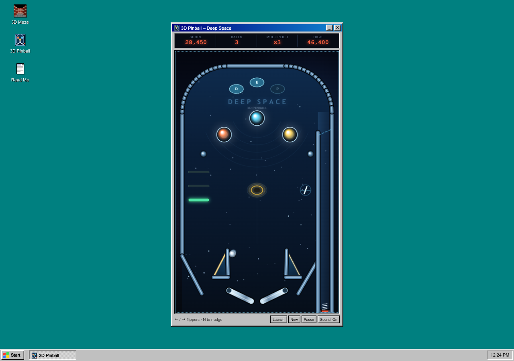

# Windows 95 desktop — 3D Maze and 3D Pinball, remade for the web

A browser Windows 95 desktop with two working programs: the **3D Maze** screen
saver — a dark brick maze that wanders around by itself, with a few rats
loitering in the dead ends — and **3D Pinball**, a complete space-themed
pinball table with real physics. The maze is rendered with a hand-written
raycasting engine and ClassicCraft block textures; the pinball table, art, and
sound are original.

**Play it:** <https://heathlogancampbell.github.io/win95maze/>


## What you get

- A procedural brick maze, re-dug every time the screen saver starts.
- Rats in random dead ends; one is always placed in a dead end on or beside the
  camera's route, so you should run into one before long. They flick their
  tails and blink.
- A camera that walks the corridors on its own, slowing into the turns.
- Textured walls, floor, and ceiling, plus distance fog and per-face shading.
- **3D Pinball**: a full table with a plunger, two flippers, pop bumpers,
  slingshots, drop targets, rollover lanes, a spinner, and a saucer.
- Physics at a fixed 240 Hz: gravity, restitution, flipper surface velocity,
  one-way gates, and enough momentum to pass from flipper to bumper and back.
- Scoring with multipliers, a target-bank bonus, an extra ball, tilt warnings,
  seven seconds of ball save, three balls, and a persistent high score.
- Synthesized Web Audio effects for the bumpers, flippers, targets, spinner,
  saucer, drain, and game over. No audio files.
- A small Windows 95 desktop around it all: icons, Start menu, taskbar buttons,
  draggable app windows, and a proper shut-down screen.
- A screen saver that runs inside the browser viewport — it never requests
  browser fullscreen and never takes over the whole display.
- Stays running until you explicitly exit with the visible **Exit** button, a
  click, or Esc. Mouse movement does not close it.
- Settings for wall blocks, puzzle size, walking speed, render quality, and
  camera bob, saved in `localStorage`.
- No build step, no dependencies, no tracking. It is just static files.

## Run it

Double-click the **3D Maze** icon, or choose **Start → 3D Maze**.
Double-click **3D Pinball**, or choose **Start → 3D Pinball**, for the table.

- **Exit the screen saver:** click the **Exit** button, click anywhere, or
  press Esc. There is no fullscreen takeover, and moving the mouse does not
  stop it.
- **Settings:** Start → Settings (or right here in the desktop shell).
- **Read Me:** double-click the Read Me icon for the about box.
- **Shut Down:** Start → Shut Down for the orange-text send-off.

### Pinball controls

| Action | Keyboard | Mouse / touch |
| --- | --- | --- |
| Left flipper | `←`, `A`, or `Z` | Click / tap the left half of the table |
| Right flipper | `→`, `D`, `/`, or `L` | Click / tap the right half |
| Plunger | Hold `Space`, release to launch | Hold **Launch**, release |
| Nudge | `N` or `↓` | — |
| New game | — | **New** button, or Enter after game over |
| Pause / resume | — | **Pause** button |

Charge the plunger for a strong launch. Tap it and the ball may not clear the
lane; you can hold **Space** again once it settles back on the spring. Each new
ball gets seven seconds of ball save after its first launch, so an early drain
is forgiven. Nudging four times in quick succession tilts the table and loses
the ball.

| The desktop shell | Properties |
| --- | --- |
|  |  |

| 3D Pinball |
| --- |
|  |

To run it locally, serve the folder over HTTP — the texture loader reads pixels
from a canvas, which browsers block on `file://`:

```bash
git clone https://github.com/HeathLoganCampbell/win95maze.git
cd win95maze
python3 -m http.server 8000
# open http://localhost:8000
```

## How it works

The renderer is deliberately old-fashioned. Scenes are drawn into a small
`ImageData` buffer (200–400 pixels on the short edge) and nearest-neighbour
upscaled, which keeps the chunky 1995 look and makes every pixel cheaper.

| File | Job |
| --- | --- |
| `js/maze.js` | Recursive-backtracker maze, extra loop carving, weighted random walk, rounded polyline path, and the camera walker. |
| `js/screensaver.js` | Canvas raycaster: DDA wall casting, textured floor/ceiling projection, distance fog, face shading, block-atlas sampling, and billboarded rat sprites. |
| `js/pinball.js` | The pinball table: fixed-step physics, segment and capsule collision, flippers, sensors, scoring, rendering, and synthesized audio. |
| `js/app.js` | Windows 95 desktop shell, window dragging, taskbar buttons, settings persistence, and screen-saver wake behaviour. |
| `assets/blocks.png` | The 16 × 768 ClassicCraft block atlas, copied byte-for-byte. |
| `assets/rat.png` | A 120 × 22 sprite sheet with three 40 × 22 rat frames: tail down, tail up, and a blink. |
| `assets/pinball.svg` | The desktop and title-bar icon for 3D Pinball. |

The maze is a standard odd-cell grid: carve with a recursive backtracker, then
knock out a few walls so the walker can loop instead of hitting dead ends. A
long random walk (biased toward going straight) becomes a smooth polyline with
quadratic corner rounding; the camera follows it at a constant distance and
eases its heading toward a point ahead on the path.

For each screen column the renderer walks the block grid with a DDA, samples
the 16 × 16 side face of the block texture, and applies a side-dependent shade
and fog. Floor and ceiling are drawn by row-wise plane casting, before the
walls are painted over them. The camera bobs on a sine wave driven by distance
travelled, not time, so it stays in step even when the tab is throttled.

Rats are billboarded sprites. Each one is placed in a dead end (one dead end is
always on the walker's path), transformed into camera space, projected onto the
screen, and clipped column-by-column against the wall depth buffer. The sprite
sheet animates a tail flick and the occasional blink.

Pinball uses the same no-assets approach. The table is a list of line segments
and circles, and the ball is a circle resolved against them twice per physics
step. Flippers are moving capsules: at the contact point the code calculates the
flipper's surface velocity from its angular speed, reflects the ball relative to
that moving surface, and adds the result back, which is what produces a real
flipper shot rather than a static bounce. The launch lane has a one-way gate
that ignores a ball travelling upward. Sensors for the rollovers, spinner, and
saucer trigger on entry rather than while overlapping, so a slow roll scores
once, not 240 times a second.

The playfield is drawn in the same canvas at 400 × 640 logical pixels and
scaled with CSS; the window itself shrinks with the viewport so it always sits
above the taskbar. Sound is a handful of oscillators and gain envelopes created
on the first user gesture, which keeps browsers' autoplay rules happy.

The block atlas stores three faces per block; the renderer uses the side face
(rows 16–31 of each 48-row slot). Textures repeat twice per world unit so the
bricks read at corridor scale. These are the slots used:

- **Brick** — slot 5
- **Cobblestone** — slot 11
- **Stone** (floor and ceiling) — slot 4

## Build notes

The maze was built in one session with an AI coding agent, and the bill is part
of the README; the pinball table was added in a follow-up session:

| | |
| --- | --- |
| **Model** | DeepSeek V4.1 Flash 1017 (`deepseek/deepseek-flash`), via OpenCode |
| **Maze build cost** | ≈ **US$0.20** of model usage for the initial build, fixes, and the rats |
| **Maze token usage** | ≈ 94k input, 73k output, 23M cached-input tokens (at $0.15/M input, $0.60/M output, $0.003/M cached read) |
| **Hosting** | **US$0.00** on GitHub Pages |

The figures are tracked by the harness; they are rounded snapshots taken while
writing this file, not an invoice.

## Textures and licence

Code is MIT licensed — see [LICENSE](LICENSE).

The block textures in `assets/blocks.png` come from
[ClassicCraft](https://github.com/HeathLoganCampbell/classiccraft) by
Heath Logan Campbell, also MIT licensed. The art is used here as-is; the maze,
renderer, pinball table, and Windows 95 shell are new. The rat sprite in
`assets/rat.png` and the pinball artwork in `assets/pinball.svg` and
`js/pinball.js` are original work for this project, as are the synthesized
sound effects.

Windows 95 and 3D Pinball are trademarks of Microsoft. This is an unofficial
fan recreation, not affiliated with or endorsed by Microsoft.
